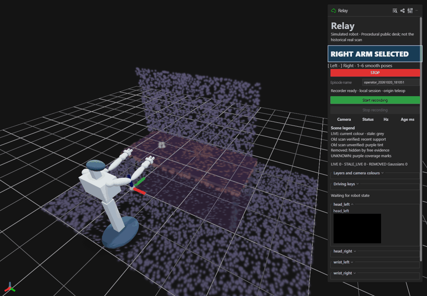
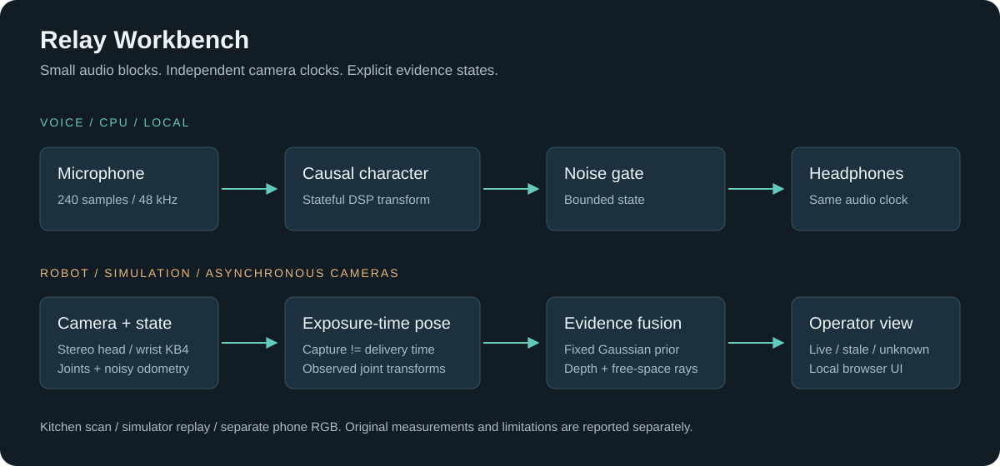

# Relay Workbench

Local robot-character audio and an operator view for a simulated mobile robot.

Two experiments share one concern: keeping useful feedback flowing while inputs
arrive in small blocks, at different rates, or late.

## Demos

### Robot and scene / 24-second loop



A full orbit around the procedural desk and robot, with scripted base, lift, head
and dual-arm poses. Kinematic illustration only: no physics, live camera feeds,
physical robot or new performance measurement.

### Voice / two real speakers, before and after

https://github.com/user-attachments/assets/09a4814e-45ed-489b-9a84-d38ac2974e98

33 seconds: **p226 original -> robot**, then **p237 original -> robot**. Both
speakers read the same sentence from CSTR VCTK 0.92. Source recordings and DSP/video
adaptations retain **CC BY 4.0**: Yamagishi, Veaux & MacDonald (2019), University of
Edinburgh CSTR, [dataset](https://doi.org/10.7488/ds/2645).
[Subtitles](docs/media/voice_demo.srt) / [source and changes](docs/media/voice_sources.json).
This illustrates the default CPU DSP; it is not a new listening or latency result.

## What it does

**Voice.** A causal, CPU-only pipeline turns microphone audio into a fixed robot
character. The default uses DSP and a noise gate, with 240-sample blocks at 48 kHz.
There is no sentence boundary or cloud service in that path. An optional neural
adapter is retained for research; its timing and quality misses are documented.

**Scene and robot.** A holonomic base, lift, two 7-DOF arms, stereo head and wrist
fisheye cameras feed a local operator view. A fixed Gaussian-splat prior is checked
against timestamped live observations. Old, live, stale and unknown geometry have
separate states. The public demo generates a procedural desk; the original home
scan and recordings are excluded.



## Quick start

Windows PowerShell, Git and **Python 3.11 x64** are the tested setup. No Git LFS,
models or GPU are needed for the default audio path, tests and replay.

```powershell
git clone https://github.com/EveningStudy/relay-workbench.git
cd relay-workbench
.\setup.ps1 -Python python
.\run.ps1 smoke
.\run.ps1 test
```

If `python` points to a different version, pass the full Python 3.11 executable
path to `-Python`. Setup creates a local `.venv` and installs the hashed lock file.
It does not download checkpoints. Installation needs Internet access; subsequent
tests and the smoke replay run offline.

The smoke replay generates a harmonic audio probe and a tiny camera/state episode,
runs the default voice pipeline and the original scene replay publisher, and writes
its outputs under `outputs/`. These are functional checks, not listening results.

### Try your microphone

Use wired headphones and microphone/output endpoints on the same physical codec.
List devices, then use their IDs:

```powershell
.\.venv\Scripts\python.exe -m sounddevice
.\run.ps1 voice --input 1 --output 3 --same-clock --seconds 60
```

Replace `1` and `3` with your own device IDs. Keys 1/2/3 select bypass, baseline
and default character; Space/Q/Esc stops. The launcher selects the model-free path.
Live audio requires Windows and working devices and was not rerun for this copy.

### Open the robot operator view

```powershell
.\run.ps1 scene
.\run.ps1 operator
```

Open [localhost:8090](http://127.0.0.1:8090). The first command creates a new
procedural Gaussian prior and robot assets. For camera feeds, run the replay
command in [the scene guide](docs/scene.md) in a second shell. For the full SAPIEN
simulator, see the optional installation and GPU requirements there.

## Results

These results were measured on the original build; this repository is a renamed
copy with new packaging, synthetic examples and procedural defaults. Original
freeze hashes and receipts do **not** certify this code. The source revision and
retained numerical evidence are described in [provenance](docs/provenance.md).

| Experiment | Recorded result | Meaning |
| --- | --- | --- |
| Default voice latency | 48.02 / 48.60 / 51.67 ms median/p95/max **estimate** | Driver timestamp delta plus a declared 42 ms allowance; not measured end to end. |
| Default heldout WER | 7/828 = 0.845% | 12 speakers, five clips each; mostly read English. |
| Neural consistency WER | 43/828 = 5.193% | Separate optional mode, not default DSP. |
| Unfamiliar speaker stress WER | Default 17.391%; neural 43.478% | One speaker, prompt referenced; distinct from heldout results. |
| Scene nominal capture-to-DOM p95 | 120.19 ms (n=775); 136.86 ms (n=743) | Two recorded runs; host/browser proxy, not physical display timing. |
| Scene change to LIVE | Mug 1.60 s; moved box 13.36 s; chair 15.87 s | All miss the 300 ms response aim. |
| Arm command to camera / DOM | No observation in 20/20 trials | Nulls retained; no passing timing inferred. |

[Full results and definitions](docs/results.md) include all 13 later timing runs,
the neural compute misses, soak scope and the failed listening criterion.

## Limitations

- The default has weak fixed-target similarity and limited pitch preservation.
  The noise gate can miss quiet speech. A character effect is not proof that every
  speaker sounds like the same recognizable identity.
- Neural conversion remains noisy on a live microphone and misses the latency aim.
  It is not part of the quick start and no weights or fixed reference are bundled.
- The one-hour voice soak was mostly quiet/gated. Physical microphone-to-speaker
  end-to-end latency has not been measured as a distribution.
- Scene-change response can take seconds even when capture-to-DOM is fast. Fusion
  does not always improve changed-region F1 over live observations alone.
- Wrist depth and noisy odometry are simulated. There is no physical robot, no
  onboard compute validation and no physical depth/display timing result.
- The procedural public example is different from the historical real desk.
  Retained result summaries cannot regenerate all historical experiments without
  the excluded data and missing historical tooling.

## Explore

- [Architecture](docs/architecture.md): audio blocks, camera timestamps and fusion boundaries
- [Voice guide](docs/voice.md) and [scene guide](docs/scene.md)
- [Results](docs/results.md) and [verification](docs/verification.md)
- [Data and media policy](docs/data.md): clone size, privacy and optional assets
- [Third-party attribution](THIRD_PARTY.md) and [licence status](docs/licensing.md)
- [Contributing](CONTRIBUTING.md)

## Licence status

Original code is licensed under [Apache-2.0](LICENSE). Third-party code and data
retain their own terms; the notices include the GPL-3.0 grant for the excluded
Seed-VC comparison. This review copy remains private until the owner approves
publication.
