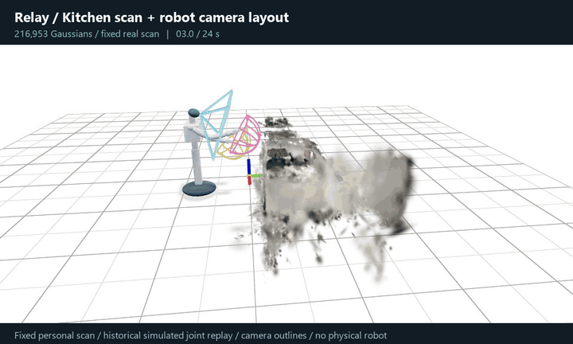

# Verification

Checked on Windows x64 with Python 3.11.17, using this repository's setup and task
launchers. No personal input, neural checkpoint or GPU was used for these checks.

| Check | Outcome | Scope |
| --- | --- | --- |
| `setup.ps1 -Python <Python-3.11-executable>` | Passed | Fresh local venv, Internet package install, hashed CPU lock. |
| `python -m pip check` in the venv | Passed | Installed package requirements consistent. |
| `run.ps1 test` | 69 passed | Original lightweight suites and synthetic default replay. |
| `run.ps1 smoke` | Passed | 48,000 audio samples; 80 camera frames, 20 joint and 20 odometry messages. |
| `run.ps1 scene` | Passed | Generated robot and 11,998 procedural Gaussians. |
| `run.ps1 operator` | Passed with renderer diagnostic below | CPU map and procedural prior loaded. |
| Browser interaction | Passed | Chrome 1440x1000; canvas focus, right-arm selection, STOP response. |
| `python scripts/results.py --check` | Passed | Page matches retained numerical summaries; no experiment rerun. |
| Release audit | Passed | Text, paths, subtitle text, media metadata, size limits and private disallowed-term list. |
| Source preservation | Passed | 51,680 source files retain their SHA-256 digests and source Git HEAD is unchanged. |

## Browser check

The Browser plugin was unavailable, so the check used installed Chrome through
Playwright. The correct page title and meaningful scene/control content rendered.
There was no framework overlay. Right-arm selection changed the visible banner;
STOP remained responsive. The screenshot is from this actual procedural operator view. The updated
24-second GIF uses the same scene/robot geometry with explicitly scripted joint
poses and an orbit camera, captured through Viser's client renderer. It does not
show physics, teleoperation or live camera observations. The new 33-second voice
film uses two approved VCTK recordings and the default DSP, not system TTS.

Pinned Viser/Three.js emits a nonfatal `computeBoundingSphere` diagnostic for an
instanced Gaussian quad with two-component positions. Inspection found zero
nonfinite values in that position buffer. The scene remains visible and interactive.
There are also upstream clock-deprecation and shader-precision warnings. These
are retained findings, not a clean-console claim.

## What this does not verify

No physical microphone/output run, listening study, new WER evaluation, neural
model installation, full GPU simulation or historical benchmark was rerun. The
small episode is a generated image/depth pattern fixture. It verifies decode,
state and transport only; publishing messages does not by itself verify receipt
by a viewer or validate geometry quality.

The original build's measurements remain historical evidence. Repackaging and
passing functional tests do not make them measurements of this renamed CPU setup.

## Demo refresh

The README now places a robot GIF and a GitHub-hosted voice player before the
architecture/quick start. The voice film is 33 seconds, using VCTK p226_003_mic2
and p237_003_mic2 with the same default DSP configuration as the live application.
Both FLAC-to-WAV source conversions preserve every decoded sample. Full video
and audio decode passed; content is based on owner-approved dataset transcripts,
not a new independent listening audit. Attribution is on screen and in the
source manifest.

The lightweight suite passed again (69 tests), and smoke replay passed with the
same 48,000 / 80 / 20 / 20 sample/message counts. An earlier concurrent test attempt
had one address-in-use failure because the preview service held port 5602; with
the service stopped, the suite passed. No product code or historical result was
changed to obtain that pass.
